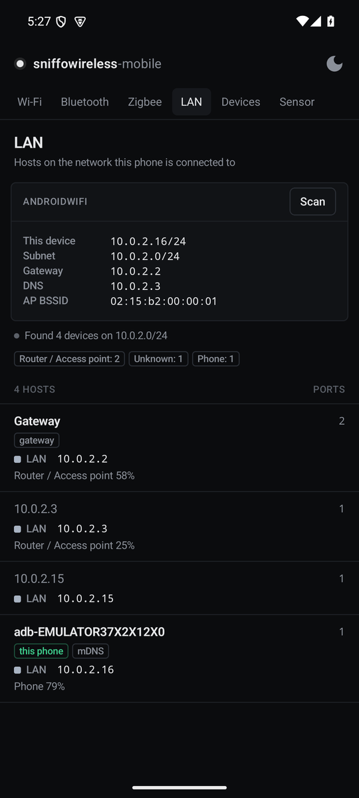
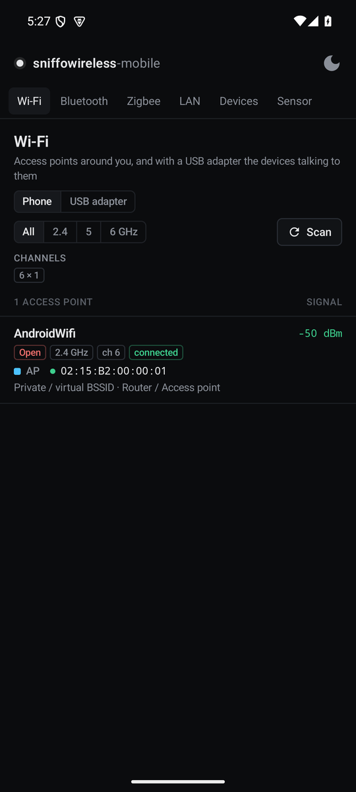
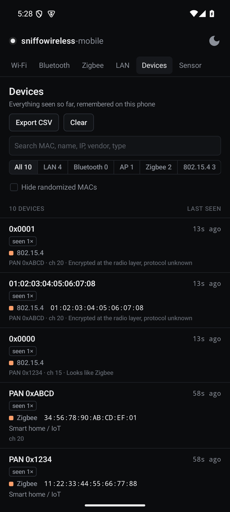
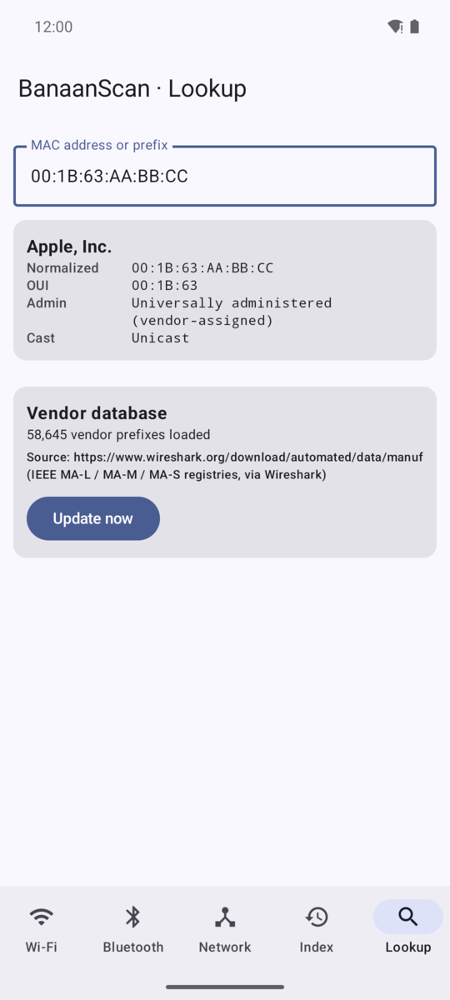
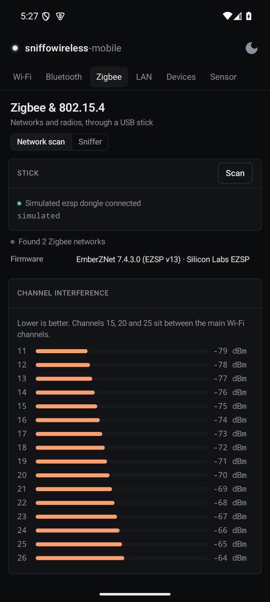
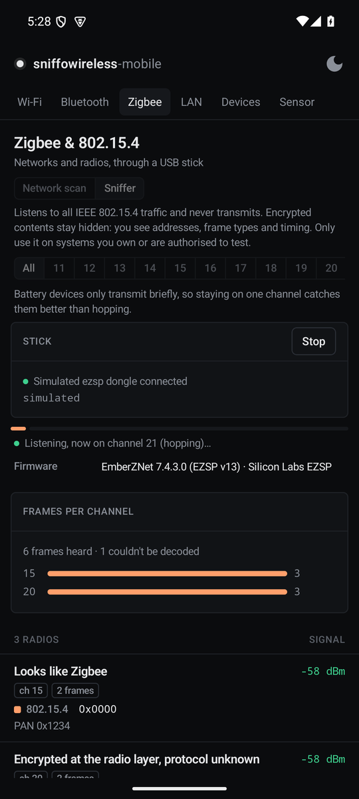

# sniffowireless-mobile

The Android companion of [sniffowireless](https://github.com/BANAANGA/sniffowireless): it captures Wi-Fi, Bluetooth
and Zigbee the way a sniffowireless sensor does, and can run as a **remote sensor** that sends everything to your
sniffowireless server, where it shows up on the map, in the device history and in the alerts like any Raspberry Pi
sensor.

On its own it is also a scanner (Kotlin + Jetpack Compose): Wi-Fi and Bluetooth, Wi-Fi monitor mode and full
Bluetooth scanning through USB adapters, Zigbee networks and IEEE 802.15.4 traffic through a USB stick, devices on the
local network, MAC vendors, device-type guesses, and an index of everything it has seen.

## Sensor for sniffowireless

1. On the server: **Settings → Sensors → Add remote sensor**, with a name and room. Copy the command it shows.
2. In the app: tap the **sensor icon** in the top bar, then **Paste from clipboard**: the server address and token
   are taken from the command. Choose what to send and press **Start**.

The phone then works like one of sniffowireless's remote sensors:

* **Same observations:** Wi-Fi frames, Bluetooth adverts and inquiry answers, and Zigbee frames are turned into
  observations by a Kotlin port of sniffowireless's own parsing code (`sniffo-core/`), with the same capability
  fingerprints, access point details, BLE identification fields and Zigbee radio summaries. The port is tested against
  fixtures that sniffowireless's Python produces (see [tools/sniffowireless](tools/sniffowireless/README.md)).
* **Sources:** the phone's own Wi-Fi scan (access points; with Android 11+ including their information elements) and
  Bluetooth, an MT7921U in monitor mode (access points, clients, probe requests, deauths, channel survey), a USB
  Bluetooth adapter (every advert, long range, classic inquiry), and a Zigbee stick (network scans, energy, and
  listening with an EZSP stick that has `mfglib`).
* **Settings from the server:** the channels and hop time set under **Settings → Wi-Fi channels**, and the channels,
  scan interval and listening under **Settings → Zigbee**, reach the phone with its next upload and are applied while it
  runs; the server shows *applied* once the phone reports the new revision.
* **Status, load and logs:** each source appears on the server's Sensors page with its state and hardware, with the
  phone's memory, disk and CPU use, and its log lines on the Logs page.
* **Keeps running:** a foreground service with a notification keeps capturing and sending with the screen off. Uploads
  go every 2 seconds; when the server can't be reached they are kept (up to 50,000 observations) and sent later.

The phone's own radios see less than a USB adapter: Android filters and merges Bluetooth adverts and only reports
access points from Wi-Fi scans (4 per 2 minutes unless throttling is turned off in Developer options). For a sensor
that runs for days, turn battery optimisation off for the app (the Sensor screen links to the setting).

## Screenshots

<table>
  <tr>
    <td align="center"><br><sub>Network discovery</sub></td>
    <td align="center"><br><sub>Device detail + type guess</sub></td>
    <td align="center"><br><sub>Wi-Fi scanner</sub></td>
  </tr>
  <tr>
    <td align="center"><br><sub>Device index</sub></td>
    <td align="center"><br><sub>MAC vendor lookup</sub></td>
    <td align="center"><br><sub>Zigbee scanner (simulated dongle)</sub></td>
  </tr>
  <tr>
    <td align="center"><br><sub>802.15.4 sniffer (simulated dongle)</sub></td>
    <td></td>
    <td></td>
  </tr>
</table>

<sub>Captured on the Android emulator before the rename, with the old colours. The emulator's virtual network only has
a gateway, a DNS server and the emulator itself. On a real home network you'll see phones, TVs, printers, smart plugs and so on. The
Zigbee and sniffer results are made up by the simulated dongle in debug builds.</sub>

## Features

| Tab | What it does |
|---|---|
| **Wi-Fi** | Lists access points: SSID, BSSID + vendor, signal, band/channel/width, Wi-Fi standard, security, channel usage. Flags hotspots / Wi-Fi Direct printers & TVs. |
| **Bluetooth** | BLE scan + classic discovery merged per address. Decodes BLE manufacturer data (Apple Continuity, Microsoft, Samsung, Garmin…), service UUIDs and the Bluetooth device class. With a USB Bluetooth adapter: every advertising packet, long range (Coded PHY), and a listen-only mode. |
| **Zigbee** | Active scan through a USB coordinator: PAN ID, extended PAN ID, channel, signal, whether the network is open for joining, and which routers answered. Silicon Labs sticks also measure interference per channel, and can passively sniff all 802.15.4 traffic: frames per channel, addresses, frame types and a protocol hint. |
| **Network** | Subnet sweep (TCP connect + ICMP), then per host: 33 common ports, reverse DNS, NetBIOS name/MAC, mDNS/DNS-SD services + TXT (Apple model IDs, Cast models, printers), SSDP/UPnP description, web page title/Server header. |
| **Index** | Persistent JSON index of every LAN/BT/Wi-Fi device with first/last seen and sighting count. Search, filter, export CSV. |
| **Lookup** | Manual MAC/OUI lookup (MA-L/MA-M/MA-S), randomized-MAC detection, and updating the vendor database. |

The app starts in dark mode. The button in the top bar cycles Dark → Light → Follow system, and the
choice is remembered.

### USB adapters

sniffowireless-mobile can drive two kinds of USB adapter itself, without root, through a USB-C cable or OTG adapter. Choose
**USB adapter** at the top of the Wi-Fi or Bluetooth tab.

* **Wi-Fi monitor mode** with a MediaTek MT7921U adapter (USB ID `0e8d:7961`): listens on 2.4, 5 and 6 GHz
  and lists networks and the devices talking in them, including probe requests. Nothing is transmitted. A capture
  for Wireshark is saved too. See [tools/mt7921u](tools/mt7921u/README.md). Compatible adapters:
  * BrosTrend AXE3000 Linux WiFi, model AX9L (tested)
  * Alfa AWUS036AXML
  * Any other adapter with the MT7921U / MT7921AUN chip that shows up as `0e8d:7961`
* **Bluetooth** with a USB Bluetooth adapter, tested with the TP-Link UB500 Plus (Realtek RTL8761BU, `2357:0604`).
  Compared with the phone's own Bluetooth it reports every advertising packet without Android's filtering, hears
  long-range (Coded PHY) devices, knows whether an address is public or random, and has a **Listen only** mode that
  transmits nothing. Without it, it asks devices for their names from a random address and also searches for
  classic devices. It doesn't follow other devices' connections: that needs sniffer hardware such as an nRF52840.
  See [tools/bthci](tools/bthci/README.md).

The adapters' firmware is bundled with the app under the chip makers' licences: MediaTek's (`assets/mt7921u/`) and
Realtek's (`assets/rtl_bt/`), both from linux-firmware.

### Device-type guessing

`classify/DeviceClassifier.kt` gives each signal points towards a type (router, phone, printer,
camera, smart home…). The highest score wins, and the gap to the runner-up sets the confidence.
Devices with too little evidence (for example a single open port) stay **Unknown** rather than getting
a shaky label. Tap any device to see the reasons behind its guess.

### Zigbee

Phones have no Zigbee radio, so this tab needs a coordinator stick connected through a USB-OTG adapter.
sniffowireless-mobile works out the firmware by asking the stick, since the USB chip doesn't reveal it.

| Firmware | Example sticks | Networks | Channel interference | Sniffer |
|---|---|---|---|---|
| TI Z-Stack | Sonoff ZBDongle-P, CC2652, CC2531 | Yes | No | No |
| Silicon Labs EZSP | Sonoff ZBDongle-E, SkyConnect, ZBT-1 | Yes | Yes | If the firmware includes `mfglib` |
| deCONZ | ConBee II | Not supported | Not supported | Not supported |

* **Read-only:** it never writes the stick's stored settings, so a scan shouldn't affect the Zigbee
  network a stick runs. This is untested on real hardware, so try a spare stick first if you have one. Unplug it from your hub first, because only one program can use it at a time,
  and that network is offline until you plug it back. Silicon Labs sticks do get a firmware restart, which
  keeps their stored data.
* **Z-Stack limits:** other tools widen a stick's channel list by rewriting it. sniffowireless-mobile doesn't, so if a
  stick is set to specific channels the app warns you that networks elsewhere may be missed. Measuring
  interference needs a running network, so it's skipped.
* **What a scan can't see:** only routers and coordinators answer. Battery sensors stay asleep, and devices
  inside other networks stay hidden. Seeing those would need sniffer firmware on the stick.

### 802.15.4 sniffer

The **Sniffer** mode on the Zigbee tab hears other 802.15.4 systems too, not just Zigbee. It uses the firmware's
manufacturing test library (`mfglib`) in receive-only mode, so no reflashing is needed if the firmware includes it;
if not, the app says so. It never transmits, and the stick restarts when you press Stop.

* **What you get:** frames per channel, PAN IDs, short and long addresses, frame types, signal strength, whether
  frames are encrypted at the radio layer, and a possible vendor for long addresses.
* **What you don't get:** encrypted contents stay hidden, and frames with radio errors are dropped.
* **Protocol labels are guesses:** "Looks like Zigbee" and "Looks like Thread" come from unencrypted fields.
  Anything else stays "Unknown protocol" or "Encrypted, protocol unknown". There's no label for specific products
  such as Aperio locks, because no verified signature for them is built in.
* **Choosing a channel:** "All channels" spends 2 seconds on each, so a full round takes about 32 seconds and short
  transmissions are easily missed. Staying on one channel works better for battery devices.

Only use it on systems you own or are authorised to test.

### Vendor database

On first launch the app downloads Wireshark's `manuf` file (IEEE OUI registries, ~58,000 prefixes) into
private storage. **Lookup → Update now** refreshes it. To work fully offline, put that file at
`app/src/main/assets/manuf` before building.

## Android limitations (worth knowing)

* **MAC addresses of other LAN devices:** Android 10+ blocks `/proc/net/arp` and `ip neigh` for apps.
  sniffowireless-mobile still tries both, but on modern phones MACs usually come only from **NetBIOS**
  (Windows/Samba/NAS) responses. For other devices, the type is guessed from mDNS, UPnP, ports and names.
* **Wi-Fi scan throttling:** apps get 4 scans per 2 minutes (can be disabled in Developer options →
  "Wi-Fi scan throttling"). Location services must be **on** to get any results.
* **BLE random addresses:** most phones/earbuds advertise with rotating private addresses, which have no
  vendor. The app uses BLE manufacturer data instead.
* Your own MAC is hidden (`02:00:00:00:00:00`) on Android 6+.

## Requirements

* Android 8.0 (API 26) or newer; targets Android 15 (API 35)
* Permissions: location and nearby devices (needed by Android for Wi-Fi and Bluetooth scans), and notifications for
  sensor mode. Nothing is sent anywhere except the vendor-database download and, in sensor mode, the observations to
  the sniffowireless server you set.
* For Zigbee: a supported USB stick, plus a phone with USB-OTG host support. Android asks for permission
  the first time you scan with a stick.
* For the USB adapter modes: an MT7921U Wi-Fi adapter or a USB Bluetooth adapter, and USB-OTG host support.

## Install with Obtainium

[Obtainium](https://github.com/ImranR98/Obtainium) installs sniffowireless-mobile from this repository's GitHub Releases and
keeps it up to date. In Obtainium, tap **Add app** and enter:

```
https://github.com/BANAANGA/sniffowireless-mobile
```

Or open this link on the phone: `obtainium://add/https://github.com/BANAANGA/sniffowireless-mobile`

The app used to be called BanaanScan (`io.github.banaanga.banaanscan`). sniffowireless-mobile has a new app ID, so
it installs as a new app: add it to Obtainium again and uninstall BanaanScan.

Every release is signed with the same key (made when the app was called BanaanScan, which is the name in its certificate). Its SHA-256 certificate fingerprint is
`67:E6:1D:67:71:BC:03:2C:6D:D9:BD:FD:1A:B4:34:41:61:8A:22:4F:EB:DF:30:6D:94:AA:68:FA:7E:4A:75:5A`; Android won't
install an update signed with anything else.

### Publishing a release

Push a version tag. The release workflow runs the tests, builds and signs the APK, and attaches it to a GitHub
Release:

```bash
git tag v1.0.1 && git push origin v1.0.1
```

The tag sets the version: `v1.2.3` becomes version name `1.2.3` and version code `10203`, so every new tag counts as
an update. The signing key comes from the repository secrets `RELEASE_KEYSTORE_BASE64`, `RELEASE_KEYSTORE_PASSWORD`,
`RELEASE_KEY_ALIAS` and `RELEASE_KEY_PASSWORD`; keep a private backup of the key, because losing it means installed
copies can't be updated.

## Build and install

You need JDK 17 and the Android SDK (platform 35). The Gradle wrapper is included. To run the unit tests:

```bash
./gradlew testDebugUnitTest
```

Emulators have no USB host, so debug builds can list a simulated Zigbee dongle (`ezsp` or `znp`):

```bash
adb shell am start -n io.github.banaanga.sniffowireless.mobile.debug/io.github.banaanga.sniffowireless.mobile.MainActivity --es simulate_zigbee ezsp
```

**Android Studio:** open the project folder and press Run.

**Command line:**

```bash
./gradlew assembleDebug
```

The APK ends up in `app/build/outputs/apk/debug/app-debug.apk`. To install it on a phone with USB
debugging enabled:

```bash
adb install -r app/build/outputs/apk/debug/app-debug.apk
```

## Testing status

Tested on the Android 15 emulator (Pixel 6 profile): all tabs, LAN scan, MAC lookup, index persistence,
rotation and the theme toggle. On a Galaxy S10 (Android 12): the app itself, Wi-Fi monitor mode through an MT7921U
and Bluetooth through a TP-Link UB500 Plus (see the [USB adapters](#usb-adapters) section).

**Sensor mode:** the observation port matches sniffowireless on its fixtures and on 14,880 real frames from MT7921U
captures (2 differ: a malformed element scapy misreads). Uploads were checked against a sniffowireless server
running from source: all observations accepted, devices identified, and the sensor and its interfaces shown. On the
Galaxy S10 the phone's own Wi-Fi and Bluetooth were sent to that server. Sensor mode with the USB adapters and a
Zigbee stick attached to the phone has not been run yet (the phone's one port was taken by the cable).

**Zigbee has not been run on a real dongle.** Its protocol code is checked by unit tests against byte
sequences computed from the [zigpy-znp](https://github.com/zigpy/zigpy-znp) and
[bellows](https://github.com/zigpy/bellows) reference implementations, and the full flow runs on the
emulator against simulated dongles. USB access, permissions and real firmware behaviour are still unproven, and
whether a given stick's firmware includes `mfglib` is only known once you try it.

## Project layout

```
app/src/main/java/io/github/banaanga/sniffowireless/mobile/
├── MainActivity.kt / MainViewModel.kt   app shell, permissions, theme, state
├── scan/       WifiScanner, BluetoothScanner, LanScanner, MdnsScanner, SsdpScanner, NetBios, Probes
├── zigbee/     USB scanner, dongle detection, Z-Stack and EZSP drivers
├── wifimon/    Wi-Fi monitor mode through an MT7921U
├── btusb/      Bluetooth through a USB adapter
├── sensor/     sensor mode: the shared Hub, SensorService (foreground service), settings
├── classify/   DeviceClassifier (type-guessing rules)
├── data/       models, OuiDatabase (MAC vendors), DeviceIndex (saved devices)
└── ui/         one screen per tab + shared components
mt7921u/        MT7921U driver (plain Kotlin), mt7921u-pc/ its PC prototype
bthci/          Bluetooth HCI over USB + Realtek firmware loader (plain Kotlin), bthci-pc/ its PC prototype
sniffo-core/    sniffowireless's observation formats ported to Kotlin, and the upload to its server (plain Kotlin)
tools/sniffowireless/  generates sniffo-core's test fixtures from a sniffowireless checkout
```

Only scan networks you own or have permission to scan.
