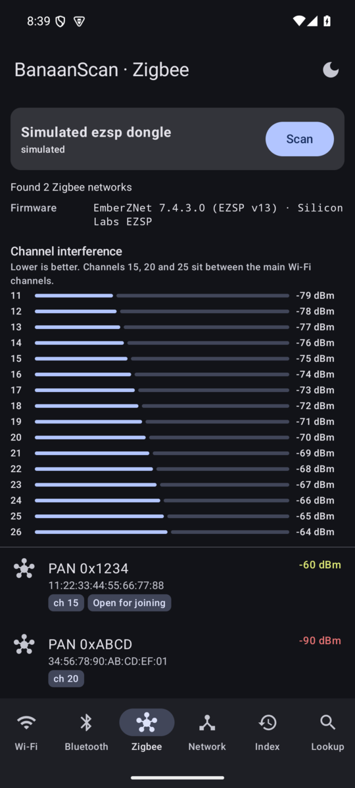
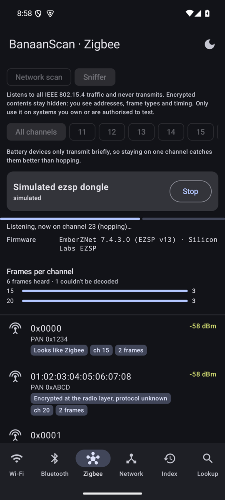

# BanaanScan

Android app (Kotlin + Jetpack Compose) that scans Wi-Fi and Bluetooth, finds Zigbee networks and listens to
IEEE 802.15.4 radio traffic through a USB dongle, discovers devices on the local network, looks up MAC vendors, guesses device types, and keeps an index of everything it has seen.

## Screenshots

<table>
  <tr>
    <td align="center"><br><sub>Network discovery</sub></td>
    <td align="center"><br><sub>Device detail + type guess</sub></td>
    <td align="center"><br><sub>Wi-Fi scanner</sub></td>
  </tr>
  <tr>
    <td align="center"><br><sub>Device index</sub></td>
    <td align="center"><br><sub>MAC vendor lookup</sub></td>
    <td align="center"><br><sub>Zigbee scanner (simulated dongle)</sub></td>
  </tr>
  <tr>
    <td align="center"><br><sub>802.15.4 sniffer (simulated dongle)</sub></td>
    <td></td>
    <td></td>
  </tr>
</table>

<sub>Captured on the Android emulator, whose virtual network only has a gateway, a DNS server and the
emulator itself. On a real home network you'll see phones, TVs, printers, smart plugs and so on. The
Zigbee and sniffer results are made up by the simulated dongle in debug builds.</sub>

## Features

| Tab | What it does |
|---|---|
| **Wi-Fi** | Lists access points: SSID, BSSID + vendor, signal, band/channel/width, Wi-Fi standard, security, channel usage. Flags hotspots / Wi-Fi Direct printers & TVs. |
| **Bluetooth** | BLE scan + classic discovery merged per address. Decodes BLE manufacturer data (Apple Continuity, Microsoft, Samsung, Garmin…), service UUIDs and the Bluetooth device class. |
| **Zigbee** | Active scan through a USB coordinator: PAN ID, extended PAN ID, channel, signal, whether the network is open for joining, and which routers answered. Silicon Labs sticks also measure interference per channel, and can passively sniff all 802.15.4 traffic: frames per channel, addresses, frame types and a protocol hint. |
| **Network** | Subnet sweep (TCP connect + ICMP), then per host: 33 common ports, reverse DNS, NetBIOS name/MAC, mDNS/DNS-SD services + TXT (Apple model IDs, Cast models, printers), SSDP/UPnP description, web page title/Server header. |
| **Index** | Persistent JSON index of every LAN/BT/Wi-Fi device with first/last seen and sighting count. Search, filter, export CSV. |
| **Lookup** | Manual MAC/OUI lookup (MA-L/MA-M/MA-S), randomized-MAC detection, and updating the vendor database. |

The app starts in dark mode. The button in the top bar cycles Dark → Light → Follow system, and the
choice is remembered.

### Device-type guessing

`classify/DeviceClassifier.kt` gives each signal points towards a type (router, phone, printer,
camera, smart home…). The highest score wins, and the gap to the runner-up sets the confidence.
Devices with too little evidence (for example a single open port) stay **Unknown** rather than getting
a shaky label. Tap any device to see the reasons behind its guess.

### Zigbee

Phones have no Zigbee radio, so this tab needs a coordinator stick connected through a USB-OTG adapter.
BanaanScan works out the firmware by asking the stick, since the USB chip doesn't reveal it.

| Firmware | Example sticks | Networks | Channel interference | Sniffer |
|---|---|---|---|---|
| TI Z-Stack | Sonoff ZBDongle-P, CC2652, CC2531 | Yes | No | No |
| Silicon Labs EZSP | Sonoff ZBDongle-E, SkyConnect, ZBT-1 | Yes | Yes | If the firmware includes `mfglib` |
| deCONZ | ConBee II | Not supported | Not supported | Not supported |

* **Read-only:** it never writes the stick's stored settings, so a scan shouldn't affect the Zigbee
  network a stick runs. This is untested on real hardware, so try a spare stick first if you have one. Unplug it from your hub first, because only one program can use it at a time,
  and that network is offline until you plug it back. Silicon Labs sticks do get a firmware restart, which
  keeps their stored data.
* **Z-Stack limits:** other tools widen a stick's channel list by rewriting it. BanaanScan doesn't, so if a
  stick is set to specific channels the app warns you that networks elsewhere may be missed. Measuring
  interference needs a running network, so it's skipped.
* **What a scan can't see:** only routers and coordinators answer. Battery sensors stay asleep, and devices
  inside other networks stay hidden. Seeing those would need sniffer firmware on the stick.

### 802.15.4 sniffer

The **Sniffer** mode on the Zigbee tab hears other 802.15.4 systems too, not just Zigbee. It uses the firmware's
manufacturing test library (`mfglib`) in receive-only mode, so no reflashing is needed if the firmware includes it;
if not, the app says so. It never transmits, and the stick restarts when you press Stop.

* **What you get:** frames per channel, PAN IDs, short and long addresses, frame types, signal strength, whether
  frames are encrypted at the radio layer, and a possible vendor for long addresses.
* **What you don't get:** encrypted contents stay hidden, and frames with radio errors are dropped.
* **Protocol labels are guesses:** "Looks like Zigbee" and "Looks like Thread" come from unencrypted fields.
  Anything else stays "Unknown protocol" or "Encrypted, protocol unknown". There's no label for specific products
  such as Aperio locks, because no verified signature for them is built in.
* **Choosing a channel:** "All channels" spends 2 seconds on each, so a full round takes about 32 seconds and short
  transmissions are easily missed. Staying on one channel works better for battery devices.

Only use it on systems you own or are authorised to test.

### Vendor database

On first launch the app downloads Wireshark's `manuf` file (IEEE OUI registries, ~58,000 prefixes) into
private storage. **Lookup → Update now** refreshes it. To work fully offline, put that file at
`app/src/main/assets/manuf` before building.

## Android limitations (worth knowing)

* **MAC addresses of other LAN devices:** Android 10+ blocks `/proc/net/arp` and `ip neigh` for apps.
  BanaanScan still tries both, but on modern phones MACs usually come only from **NetBIOS**
  (Windows/Samba/NAS) responses. For other devices, the type is guessed from mDNS, UPnP, ports and names.
* **Wi-Fi scan throttling:** apps get 4 scans per 2 minutes (can be disabled in Developer options →
  "Wi-Fi scan throttling"). Location services must be **on** to get any results.
* **BLE random addresses:** most phones/earbuds advertise with rotating private addresses, which have no
  vendor. The app uses BLE manufacturer data instead.
* Your own MAC is hidden (`02:00:00:00:00:00`) on Android 6+.

## Requirements

* Android 8.0 (API 26) or newer; targets Android 15 (API 35)
* Permissions: location and nearby devices (needed by Android for Wi-Fi and Bluetooth scans).
  Nothing is sent anywhere except the vendor-database download.
* For Zigbee: a supported USB stick, plus a phone with USB-OTG host support. Android asks for permission
  the first time you scan with a stick.

## Install with Obtainium

[Obtainium](https://github.com/ImranR98/Obtainium) installs BanaanScan from this repository's GitHub Releases and
keeps it up to date. In Obtainium, tap **Add app** and enter:

```
https://github.com/BANAANGA/banaanscan
```

Or open this link on the phone: `obtainium://add/https://github.com/BANAANGA/banaanscan`

Every release is signed with the same key. Its SHA-256 certificate fingerprint is
`67:E6:1D:67:71:BC:03:2C:6D:D9:BD:FD:1A:B4:34:41:61:8A:22:4F:EB:DF:30:6D:94:AA:68:FA:7E:4A:75:5A`; Android won't
install an update signed with anything else.

### Publishing a release

Push a version tag. The release workflow runs the tests, builds and signs the APK, and attaches it to a GitHub
Release:

```bash
git tag v0.3.0 && git push origin v0.3.0
```

The tag sets the version: `v1.2.3` becomes version name `1.2.3` and version code `10203`, so every new tag counts as
an update. The signing key comes from the repository secrets `RELEASE_KEYSTORE_BASE64`, `RELEASE_KEYSTORE_PASSWORD`,
`RELEASE_KEY_ALIAS` and `RELEASE_KEY_PASSWORD`; keep a private backup of the key, because losing it means installed
copies can't be updated.

## Build and install

You need JDK 17 and the Android SDK (platform 35). The Gradle wrapper is included. To run the unit tests:

```bash
./gradlew testDebugUnitTest
```

Emulators have no USB host, so debug builds can list a simulated Zigbee dongle (`ezsp` or `znp`):

```bash
adb shell am start -n io.github.banaanga.banaanscan/com.example.banaanscan.MainActivity --es simulate_zigbee ezsp
```

**Android Studio:** open the project folder and press Run.

**Command line:**

```bash
./gradlew assembleDebug
```

The APK ends up in `app/build/outputs/apk/debug/app-debug.apk`. To install it on a phone with USB
debugging enabled:

```bash
adb install -r app/build/outputs/apk/debug/app-debug.apk
```

## Testing status

Tested on the Android 15 emulator (Pixel 6 profile): all tabs, LAN scan, MAC lookup, index persistence,
rotation and the theme toggle. **Not yet tested on a physical phone**, so real-world Wi-Fi, Bluetooth and
home-network results are unverified.

**Zigbee has not been run on a real dongle.** Its protocol code is checked by unit tests against byte
sequences computed from the [zigpy-znp](https://github.com/zigpy/zigpy-znp) and
[bellows](https://github.com/zigpy/bellows) reference implementations, and the full flow runs on the
emulator against simulated dongles. USB access, permissions and real firmware behaviour are still unproven, and
whether a given stick's firmware includes `mfglib` is only known once you try it.

## Project layout

```
app/src/main/java/com/example/banaanscan/
├── MainActivity.kt / MainViewModel.kt   app shell, permissions, theme, state
├── scan/       WifiScanner, BluetoothScanner, LanScanner, MdnsScanner, SsdpScanner, NetBios, Probes
├── zigbee/     USB scanner, dongle detection, Z-Stack and EZSP drivers
├── classify/   DeviceClassifier (type-guessing rules)
├── data/       models, OuiDatabase (MAC vendors), DeviceIndex (saved devices)
└── ui/         one screen per tab + shared components
```

Only scan networks you own or have permission to scan.
