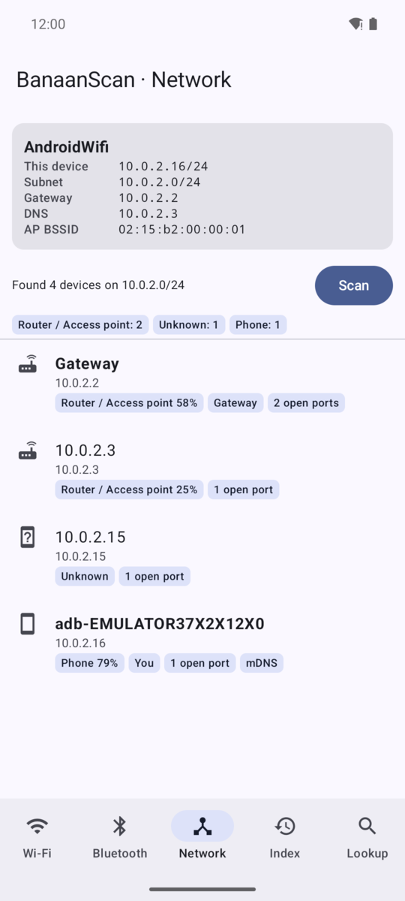
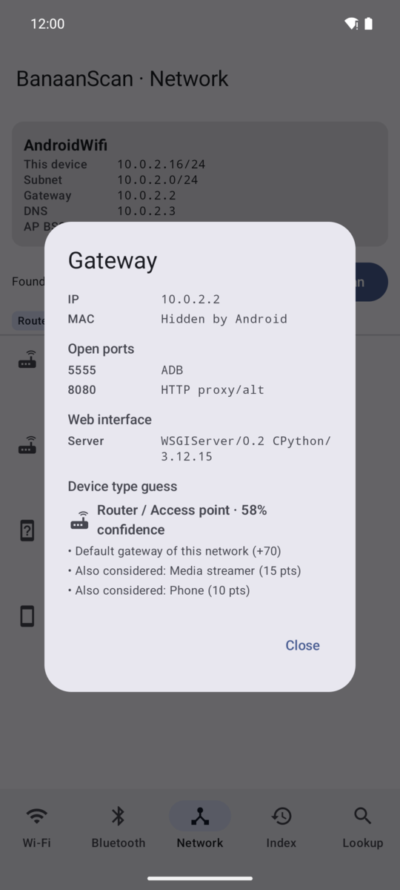
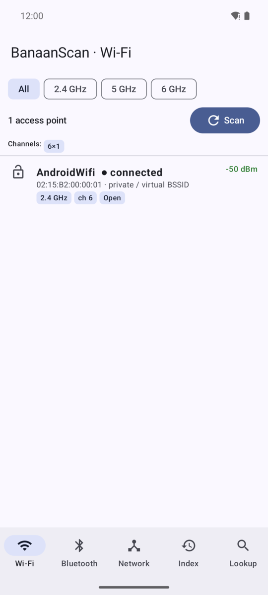
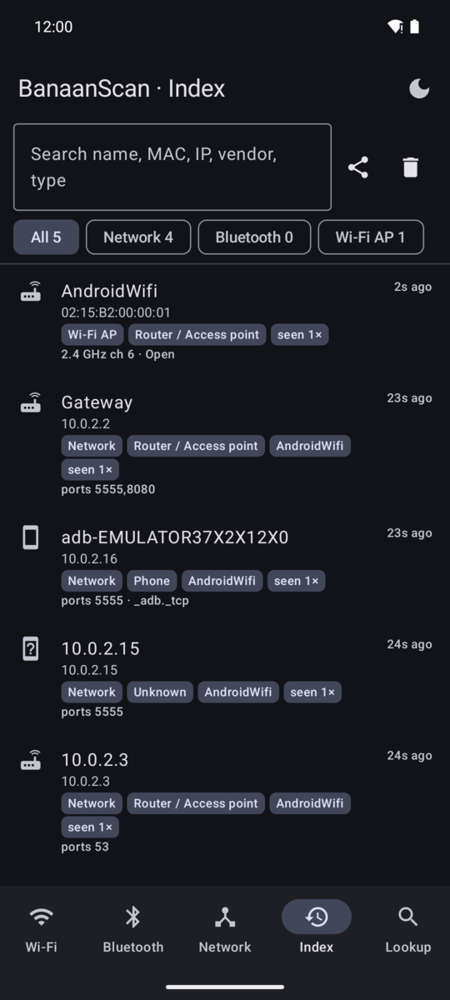
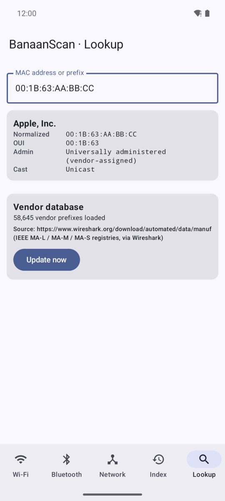

# BanaanScan

Android app (Kotlin + Jetpack Compose) that scans Wi-Fi and Bluetooth, discovers devices on the
local network, looks up MAC vendors, guesses device types, and keeps an index of everything it has seen.

## Screenshots

<table>
  <tr>
    <td align="center"><br><sub>Network discovery</sub></td>
    <td align="center"><br><sub>Device detail + type guess</sub></td>
    <td align="center"><br><sub>Wi-Fi scanner</sub></td>
  </tr>
  <tr>
    <td align="center"><br><sub>Device index</sub></td>
    <td align="center"><br><sub>MAC vendor lookup</sub></td>
    <td></td>
  </tr>
</table>

<sub>Captured on the Android emulator, whose virtual network only has a gateway, a DNS server and the
emulator itself. On a real home network you'll see phones, TVs, printers, smart plugs and so on.</sub>

## Features

| Tab | What it does |
|---|---|
| **Wi-Fi** | Lists access points: SSID, BSSID + vendor, signal, band/channel/width, Wi-Fi standard, security, channel usage. Flags hotspots / Wi-Fi Direct printers & TVs. |
| **Bluetooth** | BLE scan + classic discovery merged per address. Decodes BLE manufacturer data (Apple Continuity, Microsoft, Samsung, Garmin…), service UUIDs and the Bluetooth device class. |
| **Network** | Subnet sweep (TCP connect + ICMP), then per host: 33 common ports, reverse DNS, NetBIOS name/MAC, mDNS/DNS-SD services + TXT (Apple model IDs, Cast models, printers), SSDP/UPnP description, web page title/Server header. |
| **Index** | Persistent JSON index of every LAN/BT/Wi-Fi device with first/last seen and sighting count. Search, filter, export CSV. |
| **Lookup** | Manual MAC/OUI lookup (MA-L/MA-M/MA-S), randomized-MAC detection, and updating the vendor database. |

The app starts in dark mode. The button in the top bar cycles Dark → Light → Follow system, and the
choice is remembered.

Device-type guessing (`classify/DeviceClassifier.kt`) gives each signal points towards a type
(router, phone, printer, camera, smart home…). The highest score wins, and the gap to the runner-up
sets the confidence. Tap any device to see the reasons.

## Android limitations (worth knowing)

* **MAC addresses of other LAN devices:** Android 10+ blocks `/proc/net/arp` and `ip neigh` for apps.
  BanaanScan still tries both, but on modern phones MACs usually come only from **NetBIOS**
  (Windows/Samba/NAS) responses. For other devices, the type is guessed from mDNS, UPnP, ports and names.
* **Wi-Fi scan throttling:** apps get 4 scans per 2 minutes (can be disabled in Developer options →
  "Wi-Fi scan throttling"). Location services must be **on** to get any results.
* **BLE random addresses:** most phones/earbuds advertise with rotating private addresses, which have no
  vendor. The app uses BLE manufacturer data instead.
* Your own MAC is hidden (`02:00:00:00:00:00`) on Android 6+.

## Vendor database

On first launch the app downloads Wireshark's `manuf` file (IEEE OUI registries, ~50k entries) into
private storage. To work fully offline, put that file at `app/src/main/assets/manuf` before building.

## Build

Open the folder in Android Studio (Ladybug or newer) and press Run, or with a local SDK:

```
gradle wrapper && ./gradlew assembleDebug
```

minSdk 26 (Android 8), targetSdk 35. Only scan networks you own or have permission to scan.
